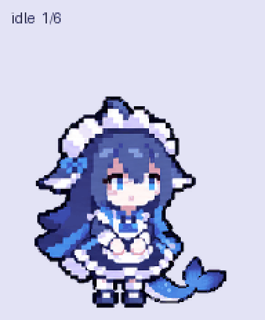

# 大肥鱼 (DaFeiYu)

A pixel-art whale-tailed maid companion with indigo hair, blue eyes, and a frilled blue-and-white dress. Created with built-in image generation and verified as selected in Pets.

The blue whale tail stays behind the dress and long hair. Right-facing poses trail the tail left; left-facing poses trail it right. Frontal resting poses may show a right-curving tail, while looking poses partly hide it behind the body near vertical gaze. The original maid outfit is preserved; the winter outfit in the anatomy reference is not part of the pet design.

The pet includes nine animation states and sixteen look directions. The final transparent sprite sheet is a 1536×2288 PNG with 73 populated cells and a file size of 2,431,505 bytes.

- [Animated preview](DaFeiYu/previews/all-states.gif)
- [Looking-around preview](DaFeiYu/previews/look-loop.gif)
- [MP4 preview](DaFeiYu/previews/all-states.mp4)
- [Final transparent sprite sheet](DaFeiYu/final/spritesheet-extended.png)
- [Editable source strips](DaFeiYu/decoded/)
- [Reference artwork](DaFeiYu/references/)
- [Generation prompts](DaFeiYu/prompts/)
- [Validation and visual QA](DaFeiYu/qa/)
- [Creation and selection record](DaFeiYu/creation-result.json)

All structural, transparency, motion, direction, blind-review, independent visual-review, and Pets preflight checks passed for the uploaded sheet. Minor reviewed limitations are subtle intermediate gaze directions and quick tail occlusion at centered vertical directions. Earlier no-tail drafts and rejected attempts have been removed; the registration issue is resolved.

Stable pet ID: `pet_6ae8cfb7749c8191b0a18ea8c1c989da`.

The root `tools/` folder contains authoring helpers for source-scale matching, body registration, row registration, and preview rendering. Include it when sharing the editable source project. It is optional for someone who only wants the finished sprite sheet or previews. These scripts use Python with Pillow and, for video rendering, imageio-ffmpeg. Full assembly and validation also used the externally installed Pets skill scripts; `match_look_source_scale.py` requires their location through `--skill-scripts`. The repository therefore contains the project-specific helpers rather than a standalone copy of the complete Pets pipeline.

Local Python environments (`.python/` and `.venv312/`), Finder metadata, and Python caches are omitted from the repository upload.
